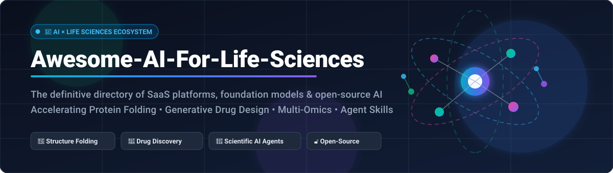

# Awesome AI For Life Sciences 🧬🔬💊

  

  
  
  
  
  
  
  

---

## 🌟 Top AI for Life Sciences Ecosystem

> **A Curated Directory of SaaS Platforms, Foundation Models, and Open-Source GitHub Projects for Computational Biology, Protein Folding, Generative Chemistry, and Autonomous Scientific Agents.**

**Last updated:** October 2026 🗓️

This repository tracks high-impact **SaaS platforms** and **open-source AI tools** for **AI in the Life Sciences**. These technologies empower biopharma researchers and computational biologists to predict biomolecular structures with atomic precision, design de novo small molecules and therapeutic proteins, process multi-omic and single-cell datasets, and build autonomous scientific research agents—accelerating preclinical discovery from decades to weeks. 🚀

Key commercial benchmarks include **Benchling**, **AlphaFold Server**, **Insilico Medicine**, **Schrödinger**, **Recursion**, **Owkin**, **Atomwise**, **Generate Biomedicines**, **Certara**, and **DNAnexus**.

---

## 📑 Table of Contents
- [📊 Sector Overview & Market Dynamics](#-sector-overview--market-dynamics)
- [☁️ SaaS / Hosted Platforms](#️-saas--hosted-platforms)
- [🔓 Open-Source GitHub Projects](#-open-source-github-projects)
- [🤝 How to Contribute](#-how-to-contribute)
- [💖 Support & Sponsorship](#-support--sponsorship)
- [📈 Star History](#-star-history)
- [⚠️ Disclaimer](#️-disclaimer)

---

## 📊 Sector Overview & Market Dynamics

The global **AI in Life Sciences market** is estimated at **~$3.2B to $4.6B in 2026** and is projected to expand at an aggressive **CAGR of 20% to 26%** toward the mid-2030s, propelled by generative biology breakthroughs and clinical milestone validations. The sector exhibits a **hybrid, moderately concentrated market structure**: while the computational infrastructure and core cloud data hosting layer are concentrated among hyperscalers and established biopharma titans, the application and model tier remains **highly fragmented**, populated by specialized TechBio startups and academic labs competing across generative protein design, virtual screening, spatial omics, and agentic research workflows. 🌐💡

---

## ☁️ SaaS / Hosted Platforms

| Platform | 🏢 Company Scale (Valuation / Market Cap / Revenue) | 🏷️ Pricing (Starting Tier) | 🎁 Free Tier / Free Trial Limits | 📝 Description |
| :--- | :--- | :--- | :--- | :--- |
| **[AlphaFold Server](https://alphafoldserver.com/)** | **~$4.0T+** Market Cap (Alphabet) / **~$1.7B** turnover (Google DeepMind) | **$0** (Non-commercial research) / Enterprise partnership via Isomorphic Labs (~$0.50/prediction at scale) | **Free forever**: 30 structure prediction jobs per day (quota resets daily at midnight BST) for non-commercial academic research | DeepMind's hosted protein & biomolecular complex structure prediction service with AlphaFold 3 capabilities (proteins, DNA, RNA, ligands, ions). |
| **[Benchling](https://www.benchling.com/)** | **~$6.1B** Valuation (Series F) / **~$210M** ARR | Commercial plans start at **~$15,000 – $20,000/year** (bundled 5-seat minimum base package) | **Free forever (Academic Tier)**: Unlimited ELN entries and Molecular Biology tools (CRISPR design, alignments); excludes enterprise LIMS/Registry modules and API access | The industry-standard R&D cloud platform for life sciences, featuring electronic lab notebook (ELN), LIMS, molecular biology tools, and CRISPR workflows. |
| **[Insilico Medicine](https://insilico.com/)** | **~$1.8B – $2.7B** Market Cap / **~$106.3M** H1 Revenue | Academic/starter access via grant programs; commercial software licenses start at **~$25,000 – $50,000/year** per enterprise module | **30-day trial / guided demo** available upon institutional/commercial qualification; free grant access provided for selected academic research labs | End-to-end generative AI drug discovery platform featuring PandaOmics (target identification) and Chemistry42 (generative small-molecule design). |
| **[Schrödinger](https://www.schrodinger.com/)** | **~$1.9B – $2.0B** Market Cap (NASDAQ: SDGR) / **~$256M** Annual Revenue | Academic research licenses start at **~$7,500 – $10,000/year**; PyMOL subscriptions start at **$500/year** (Academic) or **$2,100/year** (Small Commercial) | **PyMOL Free Educational Tier**: Free for full-time students and teachers for classroom instruction; **14-day free trial** available for Maestro/PyMOL evaluation | Computational platform for molecular modeling, physics-based simulations (Glide, Desmond, FEP+), and machine learning-guided lead optimization. |
| **[Recursion Pharmaceuticals](https://www.recursion.com/)** | **~$2.0B** Market Cap (NASDAQ: RXRX) / **~$55M** Revenue | Enterprise partnership model; co-development collaboration agreements typically starting with multi-million dollar upfront programs | **Guided demo only**: Access requires institutional partnership qualification and bespoke data agreements | Full-stack TechBio platform combining automated high-throughput biology, phenomics, and deep learning for drug discovery. |
| **[Generate Biomedicines](https://generatebiomedicines.com/)** | **~$1.8B – $2.0B** Valuation / **~$30M** Revenue | Strategic enterprise biopharma collaborations with target programs starting at multi-million dollar upfront research commitments | **Guided demo only**: Platform access is partner-gated for specific therapeutic research collaborations | Generative biology platform (The Generate Platform) utilizing generative AI algorithms to design novel protein therapeutics and antibodies. |
| **[Certara](https://www.certara.com/)** | **~$1.4B** Market Cap (NASDAQ: CERT) / **~$408M** TTM Revenue | Phoenix software desktop licenses start at **~$5,000 – $16,000/year** (average contract ~$16K, max ~$41K via procurement data) | **Free Academic Teaching License**: 100% free Phoenix desktop licenses for accredited degree-granting courses; 30-day evaluation trial for commercial prospects | Industry standard for model-informed drug development (MIDD), PK/PD modeling and biosimulation (Phoenix WinNonlin), and regulatory writing. |
| **[Owkin](https://www.owkin.com/)** | **~$1.0B** Valuation (Unicorn) / **~$30M – $50M** Revenue | Owkin K Pro co-pilot available via AWS Marketplace via private offer starting at enterprise tiers (~$50,000/year) | **14-day guided proof-of-concept / sandbox evaluation** for qualified biopharma research teams | AI biotech platform featuring federated learning and biomedical co-pilots (K Pro) for multi-cohort biomarker discovery without sharing raw patient data. |
| **[DNAnexus](https://www.dnanexus.com/)** | **~$600M** Valuation (Series I) / Multi-million enterprise run-rate | Custom AWS Marketplace private offers and enterprise agreements; research platform access starts at **~$10,000 – $25,000/year** + cloud compute usage | **Trial credit package**: £40 / $50 in compute/storage credits on select partner programs (e.g., UK Biobank RAP) valid for **90 days** from registration | Scalable bioinformatics cloud platform for population-scale genomic data management, multi-omics pipelines, and clinical research data analysis. |
| **[Atomwise](https://www.atomwise.com/)** | Undisclosed (~$219M total venture funding) / **~$10M – $16M** Revenue | Co-development licensing and upfront program-based screening access fees; academic collaborations funded via AIMS grants | **AIMS Academic Grant Program**: Free virtual screening of up to 10M molecules provided to selected academic labs per grant cycle | AI-driven virtual screening and structure-based hit discovery engine (AtomNet) predicting binding affinity across billions of small-molecule compounds. |

---

## 🔓 Open-Source GitHub Projects

> Repositories are ranked and sorted in descending order by **GitHub Stars_Count** ⭐.

| Rank | Repository & Stars_Badge | License | Category | Highlights & Capabilities |
| :---: | :--- | :---: | :---: | :--- |
| **1** | **[K-Dense-AI Scientific Agent Skills](https://github.com/K-Dense-AI/scientific-agent-skills)**  | Open-Source | Scientific Agent Skills | **The reference implementation for autonomous AI scientific workflows.** Comprehensive repository of validated skills connecting LLMs and agent frameworks (Cursor, Claude Code, MCP) to authoritative scientific databases: UniProt, PDB, ChEMBL, PubChem, Ensembl, and NCBI. |
| **2** | **[PyTorch Geometric (PyG)](https://github.com/pyg-team/pytorch_geometric)**  | MIT | Graph Neural Networks | The leading deep learning library for graph neural networks (GNNs). Foundational framework for molecular graphs, protein-protein interaction networks, and 3D molecular conformation learning. |
| **3** | **[AlphaFold](https://github.com/google-deepmind/alphafold)**  | Apache-2.0 | Structure Prediction | DeepMind's historic breakthrough predicting 3D protein structures with atomic accuracy. Landmark model in computational biology providing weights and inference pipelines. *(Non-commercial license)*. |
| **4** | **[DeepChem](https://github.com/deepchem/deepchem)**  | MIT | Molecular ML | The standard Python framework for deep learning in drug discovery, materials science, and biology. Features featurizer pipelines, GNNs, molecular docking workflows, and toxicity screening. |
| **5** | **[BioPython](https://github.com/biopython/biopython)**  | Biopython License | Bioinformatics Tooling | Foundational open-source toolkit for computational molecular biology. Essential utilities for sequence parsing, alignment algorithms, BLAST interfacing, and 3D macromolecular structure handling. |
| **6** | **[Boltz-2](https://github.com/jwohlwend/boltz)**  | MIT | Structure Prediction | Biomolecular complex structure prediction model with **AlphaFold 3-class accuracy**. Predicts protein-ligand, protein-protein, and protein-nucleic acid complexes faster and runs locally on consumer GPUs. |
| **7** | **[ESM (Evolutionary Scale Modeling)](https://github.com/facebookresearch/esm)**  | MIT | Protein Language Models | Meta AI's transformer models trained across millions of protein sequences. Includes **ESMFold** for ultrafast end-to-end structure generation without multiple sequence alignments (MSAs). |
| **8** | **[Google DeepVariant](https://github.com/google/deepvariant)**  | BSD-3-Clause | Genomic AI | Deep learning-based variant caller by Google that transforms high-throughput DNA sequencing data into images to detect single-nucleotide variants and indels with state-of-the-art precision. |
| **9** | **[RDKit](https://github.com/rdkit/rdkit)**  | BSD-3-Clause | Cheminformatics | The undisputed standard open-source cheminformatics and machine learning library. Handles 2D/3D molecular representations, substructure search, fingerprinting, and chemical descriptor calculation. |
| **10** | **[OpenFold](https://github.com/aqlaboratory/openfold)**  | Apache-2.0 | Structure Prediction | High-performance PyTorch reproduction of AlphaFold 2 supporting end-to-end training and fine-tuning with memory-efficient attention and multi-GPU scalability under the OMSF consortium. |
| **11** | **[RFdiffusion](https://github.com/RosettaCommons/RFdiffusion)**  | BSD-3-Clause | De Novo Protein Design | Breakthrough generative diffusion model for de novo protein design from the Baker Lab (David Baker, 2024 Nobel Prize). Designs targeted binders, complex scaffolds, and symmetric assemblies. |
| **12** | **[Scanpy](https://github.com/scverse/scanpy)**  | BSD-3-Clause | Single-Cell Genomics | Scalable toolkit for analyzing single-cell gene expression data. Integrates preprocessing, dimensionality reduction (t-SNE/UMAP), clustering, trajectory inference, and spatial transcriptomics. |
| **13** | **[Protenix](https://github.com/bytedance/Protenix)**  | Apache-2.0 | Structure Prediction | ByteDance's open-source reproduction and evolution of AlphaFold 3. Supports all-atom biomolecular modeling of proteins, RNA, DNA, ligands, and covalent modifications. |
| **14** | **[Open Graph Benchmark (OGB)](https://github.com/snap-stanford/ogb)**  | MIT | Benchmark Datasets | Benchmark datasets, data loaders, and evaluators for graph machine learning, including major large-scale molecular property prediction datasets (OGB-LSC, PCQM4Mv2). |
| **15** | **[Chai-1](https://github.com/chaidiscovery/chai-lab)**  | Apache-2.0 | Multi-Molecular Modeling | Chai Discovery's multi-modal foundation model for molecular structure prediction. Matches AlphaFold 3 accuracy while offering **full Apache-2.0 commercial rights** and high antibody-antigen success. |
| **16** | **[OpenMM](https://github.com/openmm/openmm)**  | MIT / LGPL | Molecular Dynamics | High-performance, GPU-accelerated molecular dynamics simulation toolkit. Widely used for protein conformational dynamics, thermodynamic integration, and drug binding free energy calculation. |
| **17** | **[ProteinMPNN](https://github.com/dauparas/ProteinMPNN)**  | MIT | Sequence Design | Deep learning neural network for inverse protein folding (designing amino acid sequences that fold into specific target 3D backbones). Frequently paired with RFdiffusion. |
| **18** | **[scvi-tools](https://github.com/scverse/scvi-tools)**  | BSD-3-Clause | Probabilistic Multi-Omics | Deep generative modeling library for single-cell omics data based on PyTorch and AnnData. Powers batch correction, differential expression, and CITE-seq multi-modal integration. |
| **19** | **[DiffDock](https://github.com/gcorso/DiffDock)**  | MIT | Molecular Docking | State-of-the-art diffusion generative model over the degrees of freedom of ligand pose and translation for blind, targeted molecular docking. |
| **20** | **[AutoDock Vina](https://github.com/ccsb-scripps/AutoDock-Vina)**  | Apache-2.0 | Molecular Docking | One of the most popular docking tools in structural biology for virtual screening and predicting ligand-receptor binding affinity. |
| **21** | **[GNINA](https://github.com/gnina/gnina)**  | GPL-2.0 | Molecular Docking | Deep learning-enhanced molecular docking engine using 3D convolutional neural networks (CNNs) for scoring and receptor-ligand pose optimization. |
| **22** | **[GROMACS](https://github.com/gromacs/gromacs)**  | LGPL-2.1 | Molecular Dynamics | Extremely versatile and fast package for molecular dynamics simulations, primarily designed for biomolecular systems such as proteins, lipids, and nucleic acids. |
| **23** | **[Nucleotide Transformer](https://github.com/instadeepai/nucleotide-transformer)**  | Apache-2.0 | Genomic Foundation Models | Pretrained foundation models for genomics developed by InstaDeep and TUM. Predicts regulatory features, splice sites, promoters, and genetic variant impacts across diverse genomes. |
| **24** | **[DGL-LifeSci](https://github.com/awslabs/dgl-lifesci)**  | Apache-2.0 | Graph AI | Deep Graph Library (DGL) extension toolkit implementing graph models for molecular property prediction, reaction prediction, and RNA/protein structures. |
| **25** | **[Squidpy](https://github.com/scverse/squidpy)**  | BSD-3-Clause | Spatial Omics | Spatial single-cell analysis toolkit built on AnnData and Scanpy. Explores cell-cell communication, neighborhood enrichment, and tissue architecture. |
| **26** | **[PLUMED](https://github.com/plumed/plumed2)**  | LGPL-3.0 | Enhanced Sampling | Community-developed library for enhanced sampling, free-energy calculation, and analyzing molecular dynamics trajectories in OpenMM and GROMACS. |

---

## 🤝 How to Contribute

Contributions from researchers, software engineers, and bioinformaticians are warmly encouraged! 🎉

1. 🍴 **Fork** this repository.
2. 🌿 **Create a new branch** (`git checkout -b feature/add-new-tool`).
3. ✏️ **Add or update** entries in [README.md](README.md) following the existing tabular schema.
4. 📝 Ensure you include the platform name, official URL, pricing tier / free limits (for SaaS), or repo link and license (for open-source).
5. 🚀 **Submit a Pull Request** with a brief summary of the addition!

---

## 💖 Support & Sponsorship

If you find this repository valuable for your research, lab projects, or biotech development, please consider showing your support:

- ⭐ **Star this repository** to help others discover it!
- 🍴 **Fork and share** it with your research group and colleagues.
- ☕ **Sponsor / Buy a Coffee**: Support ongoing curation and open-source scientific tools via the **[GitHub Sponsors Dashboard](https://github.com/sponsors/ishandutta2007)**!

Thank you so much to all the contributors and sponsors who keep open science thriving! 🧬✨

---

## 📈 Star History

---

## ⚠️ Disclaimer

- This is a **community-curated** list — not exhaustive and not an endorsement.
- AI for life sciences tools are **research aids, not clinical decision systems**. All predictions require rigorous experimental and wet-lab validation before clinical or therapeutic use. **Regulatory compliance (FDA, EMA) remains mandatory** for any diagnostic or therapeutic development.
- **Model licensing varies significantly:** AlphaFold 2 is Apache-2.0 but commercial use of weights requires licensing from DeepMind. Chai-1 is fully Apache-2.0 for commercial and non-commercial use. Boltz-2 is MIT licensed. Always verify licensing before commercial deployment.
- Computational predictions represent testable hypotheses—wet-lab validation and in vivo experiments remain the ultimate ground truth in drug discovery and therapeutic biology.

---

  <b>Built for computational biologists, drug discovery teams, and developers engineering the future of life sciences AI.</b> 
  Let's make AI for Life Sciences more open, reproducible, and scientifically validated! 🔬🧬🚀

